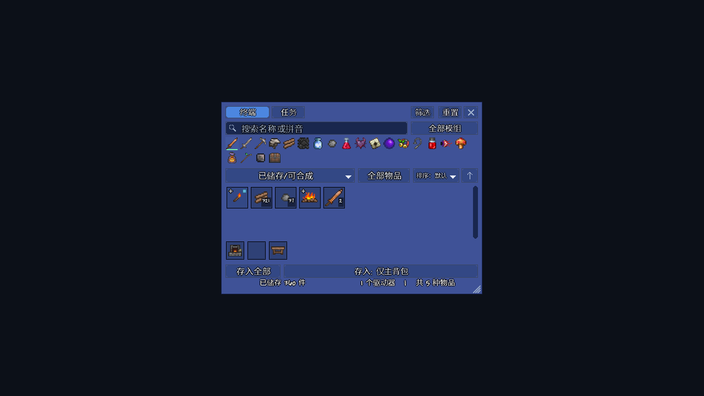
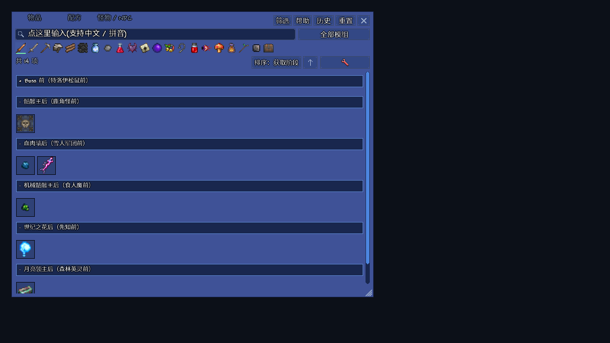

# AE2 for Terraria

把 **ME 网络存储、自动合成与物品查询**带进 Terraria 的 tModLoader 模组。查询物品、配方、用途与掉落，集中存取材料，在终端管理制作任务、库存目标与网络权限。

当前源码版本 **0.27.14**，以 [build.txt](AE2ForTerraria/build.txt) 为准。原创代码采用 [MIT](LICENSE)；这是一款独立社区模组，与 Minecraft Applied Energistics 2、Re-Logic 或 tModLoader 官方无隶属关系。

## 界面





截图来自 0.27.11 的实际 UI 回归，展示终端和获取阶段；不表示当前版本所有内容均在截图中展示。截图中的游戏与其他模组素材归各自权利方，MIT 许可覆盖本项目原创代码。

## 安装与预览

从 [Releases](https://github.com/S4kuzy0/AE2ForTerraria/releases) 下载已发布的预览包 `.tmod` 与校验值（可能早于当前源码版本）；在 tModLoader 菜单打开实际使用的 `Mods` 文件夹，放入安装包，启用 **AE2 for Terraria** 后重新加载。默认按 **Tab** 打开物品浏览器。

第一次使用可按 [入门演示](docs/quickstart.md) 搭建最小网络。安装包不包含 Terraria、其他模组或个人存档。

## 主要功能

| 模块 | 功能 |
| --- | --- |
| 物品与怪物查询 | 名称、拼音、模组分类，配方、用途、掉落、套装说明、历史与收藏材料树 |
| ME 存储 | 驱动器、磁盘、存储单元、分区过滤，保留词缀和自定义物品身份 |
| 合成终端 | 同窗存取、制作任务、工作站、缺料分析与保持库存 |
| 网络管理 | 线缆、无线桥接、命名、权限、物品锁定、审计和网络转移 |
| 自动收集 | 掉落收集器、随身磁铁、原版箱子导入和导出 |
| 获取阶段 | 结合已建模的采集、掉落、商店与配方路线分组，可调整个人 Boss 顺序 |

存储总线目前只支持原版箱子系统。未知第三方条件保留未知；特殊合成回调可能仍需手动制作。查询功能尚未完成与 Recipe Browser 的全功能对等验收。旧访问设备为兼容而保留，主要使用合成终端。

0.27.14 加固模组变动后的数据适配：过滤名单和库存目标保留稳定身份，重新加载时重建派生索引，阶段条件读取当前注册的布尔规则。复杂兼容来源按具体路线检查，只暂停无法确认的路线。Wiki、实现依据及边界见[获取来源](docs/acquisition-sources.md)。

## 环境与兼容性

已在实际启用的模组环境完成菜单核心及界面回归；范围与限制见[维护手册](docs/maintenance.md)。普通更新和内容增减尽量由当前注册数据适配；任意第三方私有接口或复杂规则彻底变化仍可能需要维护，未知规则不会冒充已验证来源。

历史验证环境：Windows、Terraria 1.4.4.9、tModLoader 2026.08.3.0、.NET 8。源码使用 C# 12。Calamity、Fargo、BossChecklist 是可选兼容来源或测试环境组成，不是强制依赖。多人使用须保持模组版本一致；现有测试不能替代所有版本、模组组合与真实双客户端验收。

## 从源码构建

```powershell
git clone https://github.com/S4kuzy0/AE2ForTerraria.git
Set-Location AE2ForTerraria
$env:TML_INSTALL = Read-Host 'tModLoader installation directory'
pwsh -File tools/build.ps1
```

构建工具使用**新建的隔离存档目录**，将包和 SHA-256 清单输出至 `dist/`，不覆盖日常游戏的 Mods 或存档。输出已存在时拒绝覆盖，可指定新的 `-OutputDirectory`。开发者也可执行：

```powershell
dotnet build AE2ForTerraria/AE2ForTerraria.csproj -p:TmlInstall="$env:TML_INSTALL" -p:BuildMod=false
```

这条命令只编译，不安装或生成 `.tmod`。在标准 ModSources 布局下也支持父级 `tModLoader.targets`；无须修改源码写入个人路径。

## 验证与开发

- 本地构建、既有回归 harness 与实机历史边界见 [维护手册](docs/maintenance.md)。
- 开发诊断只在显式 `AE2_*` 开关下启用；输出根可用 `AE2_VALIDATION_ROOT` 指定，默认游戏存档目录下的 `AE2-Validation`。
- `tools/run_client_validation.ps1` 需要显式安装目录，旅程还需调用者自己的世界副本夹具；不会从源码仓库下载世界或承诺全新克隆可复现私人历史场景。
- 提交前运行 `python tools/check_git_upload.py`；它检查 Git 暂存内容，不能替代完整的秘密与历史审计。
- 日常存档、个人配置、提取的游戏资源、验证输出和恢复副本不入库。历史提交不因当前路径清理而自动消失；本轮不重写公共历史。

## 文档

| 文档 | 内容 |
| --- | --- |
| [玩家指南](AE2ForTerraria/README.md) | 设备、操作和容量规则 |
| [入门演示](docs/quickstart.md) | 最小网络与操作示例 |
| [需求与验收](docs/requirements.md) | 功能边界和应满足的行为 |
| [获取来源](docs/acquisition-sources.md) | 获取阶段推导的来源与限制 |
| [设计](docs/design.md) | 数据、网络与模块结构 |
| [维护](docs/maintenance.md) | 构建、测试、历史验证与排错 |
| [项目记忆](docs/project-memory.md) | 已确认决策与接续背景 |

## 许可与第三方

原创代码采用 [MIT](LICENSE)。参考图形的来源与版权通知见 [ThirdPartyNotices.txt](AE2ForTerraria/ThirdPartyNotices.txt)，分发时应一并保留。Terraria、tModLoader、其他模组及其素材不因本项目许可而获得额外授权。
